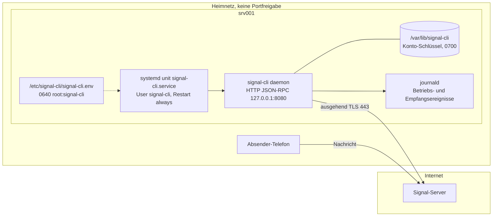
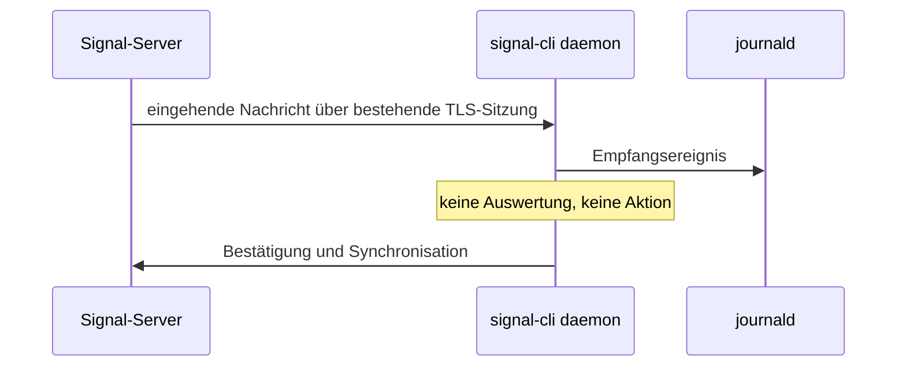

# Solution Design: HAD-0001 – Signal-Empfang auf srv001

## Metadaten

| Feld | Wert |
| :--- | :--- |
| Ticket | HAD-0001 (siehe `backlog.md`) |
| Feature / Epic | Signal-Integration |
| Priorität | High |
| Übergreifendes Design | `specs/signal-integration/design.md` |
| Dokumenttyp | Solution Design, umsetzungsbegleitend |
| Status | Entwurf, noch nicht umgesetzt |
| Gültig für | ausschließlich den Empfangsdienst; keine Befehlsauswertung |

Dieses Dokument beschreibt die konkrete Umsetzung von HAD-0001. Es ändert das
übergreifende Design in `specs/signal-integration/design.md` nicht und ersetzt
es nicht. Bei
Widersprüchen gilt das Ticket in `backlog.md`, danach dieses Dokument.

## Ziel

`signal-cli` soll auf dem Ubuntu-Server `srv001` als dauerhaft laufender Dienst
ein dediziertes Signal-Konto empfangen. Eingehende Nachrichten werden
ereignisbasiert entgegengenommen, nicht per Cronjob abgefragt. Der Dienst startet
nach einem Neustart des Servers automatisch, läuft unter einem eingeschränkten
Dienstbenutzer und benötigt keine eingehenden Verbindungen oder Portfreigaben aus
dem Internet. Konto-Schlüssel liegen persistent in einem nur für den Dienst
lesbaren Verzeichnis.

## Abgrenzung

HAD-0001 liefert **nur** Empfang und Betriebsfähigkeit des Dienstes. Bewusst
**nicht** enthalten:

| Thema | Zuständiges Ticket |
| :--- | :--- |
| Absender-Allowlist und Chat-Log | HAD-0002 |
| Erkennung der Kommandos `HO M an/aus/Status` | HAD-0003 |
| Aufruf von Home Assistant | HAD-0004 |
| Signal-Antworten und Fehlermeldungen an den Absender | HAD-0005 |
| End-to-End-Abnahme und Sicherheitsprüfung | HAD-0006 |
| Verwaltungsoberfläche | HAD-0008 |

Daraus folgt eine harte Regel für die Umsetzung: **Der Dienst wertet in diesem
Ticket keine Nachricht aus und löst keine Aktion aus.** Er empfängt und macht den
Empfang nachweisbar. Es entsteht kein generischer Proxy, keine
Home-Assistant-Verbindung und kein ausgehender `send`-Pfad im Regelbetrieb.

## Ausgangslage und Annahmen

| Nr. | Annahme | Status |
| :--- | :--- | :--- |
| A1 | `srv001` läuft Ubuntu LTS mit `systemd` und ist im Heimnetz erreichbar | bestätigt: Ubuntu 26.04.1 LTS, systemd 259 |
| A2 | Architektur `x86_64` oder `arm64`; entscheidet JVM- oder nativer Build | bestätigt: `x86_64` |
| A3 | Passende JRE verfügbar: `signal-cli` 0.14.x ist gegen Java 25 kompiliert | bestätigt: `openjdk-25-jre-headless` in den Standardquellen, Installation in S2 |
| A4 | Eine dedizierte Signal-Nummer kann SMS oder Sprachcode empfangen | **entschieden**: Mobilfunknummer mit SMS erforderlich. Festnetz wurde mit zwei Nummern getestet und beide Male mit `400 InvalidTransportModeException` abgelehnt |
| A5 | Ausgehende Verbindungen zu Signal (TLS 443) sind erlaubt | bestätigt: `signal.org` HTTP 200 |
| A6 | Auf srv001 existiert keine Firewall-Regel, die eingehend benötigt wird | offen: `ufw` inaktiv, kein Host-Firewall-Nachweis möglich |

Offene Punkte werden in S0 geschlossen, bevor S2 beginnt. Wird A4 verneint, ist
die Umsetzung zu stoppen und das Ticket erneut zu bewerten: Das Verknüpfen eines
persönlichen Kontos gäbe dem Dienst Einblick in alle privaten Chats und ist mit
HAD-0002 noch nicht abgesichert.

## Architektur



Die Verbindung entsteht immer von `srv001` nach außen. Für den Empfang ist kein
Listener am Server nötig; der lokale JSON-RPC-Port dient nur der späteren
Anbindung des Befehlsdienstes aus HAD-0002 ff. und bleibt auf Loopback
beschränkt.

### Laufzeitverhalten im Ticketumfang



## Entscheidungen

| ID | Entscheidung | Begründung |
| :--- | :--- | :--- |
| E1 | Eigener Systembenutzer `signal-cli` ohne Login-Shell und ohne `sudo` | Rechtebegrenzung; Kompromittierung des Dienstes darf keine Root-Rechte ergeben |
| E2 | Eigener Benutzer ist **nicht** dasselbe wie das Signal-Konto | Linux-Identität und Messenger-Identität sind getrennte Konzepte |
| E3 | `daemon`-Modus statt periodischem `receive` | Anforderung ist ereignisbasierter Empfang ohne Cronjob (siehe `specs/signal-integration/design.md`) |
| E4 | Lokaler Zugriff über `127.0.0.1:8080`, nicht über öffentliche Bindung | Der Port kann Nachrichten senden und ist damit ein privilegierter Kanal |
| E5 | Nummer in `EnvironmentFile`, nicht im Unit-File oder Repository | Telefonnummer ist personenbezogen; Trennungsprinzip Konfiguration und Dokumentation |
| E6 | `Restart=always` mit `RestartSec=10` | Erfüllt Autostart und deckt zusätzlich Abstürze und Netzausfälle ab |
| E7 | systemd-Sandbox ohne `MemoryDenyWriteExecute` | Ein JVM-Dienst benötigt beschreibbaren Speicher für den JIT; die Option würde den Start verhindern |
| E8 | Empfangene Nachrichteninhalte werden nicht dauerhaft protokolliert | Das Chat-Log samt Aufbewahrungsfrist ist HAD-0002; HAD-0001 braucht nur Empfangsnachweis. Der Daemon läuft deshalb mit `--no-receive-stdout`, damit keine Nachrichteninhalte im Journal landen |
| E9 | JVM-Build als Standardweg, nativer Build nur bei nicht verfügbarer passender JRE | `signal-cli` 0.14.x ist gegen Java 25 kompiliert; eine ältere JRE endet in `UnsupportedClassVersionError`. Die JRE-Anforderung wird aus den Release-Notes übernommen, nicht angenommen |
| E10 | Verifizierungscodes und Nummern werden nie in Chat, Repository oder Doku übertragen | Secrets und personenbezogene Daten bleiben auf dem Server |
| E11 | Anzeigename des Kontos: `SHNYK HA BOT` | Eindeutige Zuordnung im Chatverlauf; der Name ist frei wählbar, nicht eindeutig und jederzeit ohne Neuregistrierung änderbar |
| E12 | Registrierung in der Signal-App und Anbindung per `signal-cli link` wird nicht verwendet | Das Konto bliebe an ein Primärgerät gebunden, das erreichbar bleiben muss, und ein verknüpftes Gerät sieht alle Chats des Kontos. Nur als letzter Ausweg mit vorheriger Designänderung und nach Umsetzung von HAD-0002 |

## Umsetzungsschritte

Jeder Schritt hat einen Nachweis. Ein Schritt gilt erst als erledigt, wenn der
Nachweis vorliegt. Befehle werden vom Benutzer auf `srv001` ausgeführt; es werden
keine Zugangsdaten, Codes oder Schlüssel an anderer Stelle geteilt.

### S0 – Inventur und Entscheidungsgrundlage

- [x] Betriebssystem, Architektur, Java- und systemd-Version erfassen
- [x] Ausgehende Verbindung zu Signal prüfen
- [ ] Entscheidung dedizierte Nummer bestätigen (A4)

```bash
lsb_release -ds
uname -m
java -version 2>&1 | head -n 1
systemctl --version | head -n 1
curl -sS -o /dev/null -w '%{http_code}\n' https://signal.org/
```

Ergebnis vom 2026-11-12:

| Prüfung | Ergebnis |
| :--- | :--- |
| Betriebssystem | Ubuntu 26.04.1 LTS |
| Architektur | `x86_64` |
| Java | nicht installiert, Installation in S2 erforderlich |
| systemd | 259 |
| `signal-cli` | nicht installiert |
| Port 8080 | frei |
| Ausgehend zu Signal | `signal.org` HTTP 200 |
| Firewall | `ufw` inaktiv, kein Host-Firewall-Nachweis möglich |
| Freier Platz | 90 GB unter `/` |

Auswertung:

| Ergebnis | Konsequenz |
| :--- | :--- |
| Passende JRE im Repo | JVM-Build mit genau der von `signal-cli` geforderten Java-Version |
| Keine passende JRE im Repo | Native Build verwenden oder JRE-Anforderung gegen die Release-Notes prüfen (E9) |
| `arm64` | native Build-Verfügbarkeit prüfen, im Zweifel JVM-Build |
| A4 verneint | Stop, Ticket erneut bewerten |

**Nachweis:** Ausgabe der fünf Befehle liegt vor; Build-Variante ist festgelegt
(JVM-Build, da `x86_64` und Ubuntu 26.04; JRE-Installation ist Teil von S2).

### S1 – Dienstbenutzer und Verzeichnisse

- [x] Systembenutzer und Gruppe anlegen
- [x] Datenverzeichnis mit `0700` anlegen
- [x] Konfigurationsverzeichnis mit `0750 root:signal-cli` anlegen

```bash
sudo adduser --system --group --home /var/lib/signal-cli \
     --shell /usr/sbin/nologin signal-cli
sudo install -d -o signal-cli -g signal-cli -m 0700 /var/lib/signal-cli
sudo install -d -o root -g signal-cli -m 0750 /etc/signal-cli
```

**Nachweis:** `id signal-cli` zeigt keine Shell und keine Gruppen mit
Sonderrechten; `stat -c '%a %U:%G' /var/lib/signal-cli /etc/signal-cli` liefert
`700 signal-cli:signal-cli` und `750 root:signal-cli`.

Erfüllt am 2026-11-12: `uid=108(signal-cli) gid=114(signal-cli)`, Shell
`/usr/sbin/nologin`, keine Fremdgruppen, `700 signal-cli:signal-cli` und
`750 root:signal-cli`.

### S2 – signal-cli installieren

- [x] Java-Verfügbarkeit klären: `openjdk-25-jre-headless` verfügbar
- [x] JRE-Anforderung aus den Release-Notes prüfen: 0.14.10 benötigt Java 25
- [x] Release-Version festlegen und Prüfsumme verifizieren: `0.14.10`, `OK`
- [x] Nach `/opt` entpacken und versionierten Symlink setzen
- [x] Installation auf `root`-Eigentum belassen
- [x] JRE 25 installieren und `java -version` prüfen
- [x] `signal-cli --version` erfolgreich ausführen

```bash
sudo apt-get install -y openjdk-25-jre-headless
sudo apt-get purge -y openjdk-21-jre-headless
java -version

VER=0.14.10
SHA256=706a57d9faae7525cf732936efdabf210146e3c83f9e8ae7e4e62f5946121c33
cd /tmp
BASE="https://github.com/AsamK/signal-cli/releases/download/v${VER}"
curl -fLO "${BASE}/signal-cli-${VER}.tar.gz"
echo "${SHA256}  signal-cli-${VER}.tar.gz" | sha256sum -c -

sudo tar -xzf "signal-cli-${VER}.tar.gz" -C /opt
sudo ln -sfn "/opt/signal-cli-${VER}" /opt/signal-cli
sudo chown -R root:root "/opt/signal-cli-${VER}"
/opt/signal-cli/bin/signal-cli --version
```

Hinweise: Die Releases enthalten **keine** `.sha256sum`-Datei, sondern
`.asc`-Signaturen. Der erwartete Digest stammt aus dem `digest`-Feld des Assets in
der GitHub-Releases-API und ist bei einem Versionswechsel dort neu zu ermitteln.
Eine GPG-Prüfung der `.asc`-Datei ist möglich, benötigt aber den Signaturschlüssel
von AsamK aus einer vertrauenswürdigen Quelle und ist für HAD-0001 optional. Bei
fehlendem Java 21 den nativen Build derselben Version nutzen. Der Dienstbenutzer
erhält nur Leserechte, keine Schreibrechte unter `/opt`.

**Nachweis:** `--version` gibt `0.14.10` aus; `sha256sum -c -` meldet
`signal-cli-0.14.10.tar.gz: OK`; `java -version` zeigt Java 25.

Erfüllt am 2026-11-12: `openjdk-25-jre-headless` installiert und als Standard
gesetzt (`/usr/lib/jvm/java-25-openjdk-amd64`), `openjdk-21-jre-headless`
entfernt, `signal-cli --version` gibt `0.14.10` aus.

Abweichung am 2026-11-12: Prüfsumme und Symlink waren korrekt, der erste
Startversuch mit Java 21 scheiterte jedoch mit `UnsupportedClassVersionError`
(class file version 69). Die JRE-Anforderung war falsch angenommen. Korrigiert
durch Installation von Java 25 und Entfernen von Java 21, zusätzlich feste
`JAVA_HOME`-Vorgabe in der Unit gegen Mehrdeutigkeit bei mehreren JREs.

### S3 – Konto registrieren

Befund vom 2026-11-13: Zwei Festnetznummern wurden geprüft, beide lehnte Signal
mit `400 InvalidTransportModeException` ab. Der Sprachcode-Weg ist damit für
Festnetzanschlüsse nicht nutzbar. S3 setzt eine Mobilfunknummer voraus, die
mindestens einmal eine SMS empfangen kann. Der Sprachcode bleibt als Rückfall für
Mobilfunknummern dokumentiert, bei denen die SMS nicht ankommt.

Vorbereitung der Mobilfunknummer:

1. SIM beim Anbieter aktivieren; in Deutschland ist dafür eine Identifizierung
   erforderlich. Eine unaktivierte Karte empfängt keine SMS.
2. SIM in ein beliebiges Telefon einlegen und den SMS-Empfang mit einer
   Testnachricht von einem anderen Anschluss prüfen.
3. Die zugeteilte Nummer notieren und im Format `+49...` verwenden:
   Ländervorwahl mit `+`, danach die Nummer ohne führende Null und ohne
   Leerzeichen, Schrägstriche oder Bindestriche. Beispiel: `0171 1234567` wird zu
   `+491711234567`. Dieselbe Schreibweise ist in S4 für `SIGNAL_ACCOUNT`
   erforderlich.
4. Die SIM aufbewahren. Die Nummer wird bei einer späteren Neuregistrierung
   erneut benötigt. Das Telefon ist nur SMS-Empfänger und wird nicht zum
   Signal-Gerät.

- [x] Nummer auf dem Server hinterlegen
- [x] Captcha-Token erzeugen
- [x] SMS-Verifikation anfordern (`register --captcha`)
- [x] Nur bei Bedarf: nach mindestens einer Minute Sprachcode anfordern
- [x] Code verifizieren
- [x] Profilnamen setzen und Schlüsseldateien prüfen

Erfüllt am 2026-11-16: Mobilfunknummer registriert, `listAccounts` führt sie als
einziges gültiges Konto, Schlüsseldateien unter `data/` mit `0600`. Die beiden
Festnetzversuche hinterließen Einträge, die `listAccounts` als
`NotRegisteredException` meldet; sie sind funktionslos, sollten aber aufgeräumt
werden, damit die Zuordnung eindeutig bleibt.

```bash
ACC='+49...'

# 1. SMS-Verifikation anfordern
sudo -u signal-cli /opt/signal-cli/bin/signal-cli \
     --config /var/lib/signal-cli -a "$ACC" \
     register --captcha 'signalcaptcha://...'

# 2. Nur falls keine SMS ankommt: nach mindestens einer Minute Sprachcode
sleep 60
sudo -u signal-cli /opt/signal-cli/bin/signal-cli \
     --config /var/lib/signal-cli -a "$ACC" \
     register --voice --captcha 'signalcaptcha://...'

# 3. Code verifizieren
sudo -u signal-cli /opt/signal-cli/bin/signal-cli \
     --config /var/lib/signal-cli -a "$ACC" verify <code>

# 4. Anzeigename setzen (E11)
sudo -u signal-cli /opt/signal-cli/bin/signal-cli \
     --config /var/lib/signal-cli -a "$ACC" updateProfile --name 'SHNYK HA BOT'
```

Für den zeitkritischen Ablauf werden die Schritte in einem Block ausgeführt. Der
Block wird **vor** dem Lösen des Captchas gestartet, sodass die
Eingabeaufforderung bereits wartet; nach dem Kopieren der Linkadresse genügen
Einfügen und Enter. Die Klammern fassen den Ablauf zusammen, damit ein Abbruch
nicht die Shell-Sitzung beendet. `sudo -v` steht vor der Captcha-Abfrage, damit
die Passwortabfrage nicht zwischen Kopieren und Absetzen fällt.

```bash
(
set -u
read -r -p 'Nummer (+49...): ' ACC
echo "Laenge: ${#ACC}"
sudo -v || exit 1
read -rs -p 'Captcha: ' CAP; echo
[ -n "$CAP" ] || { echo 'Abbruch: kein Token'; exit 1; }
sudo -u signal-cli /opt/signal-cli/bin/signal-cli --config /var/lib/signal-cli -a "$ACC" register --captcha "$CAP" || exit 1
read -rs -p 'Code: ' CODE; echo
[ -n "$CODE" ] || { echo 'Abbruch: kein Code'; exit 1; }
sudo -u signal-cli /opt/signal-cli/bin/signal-cli --config /var/lib/signal-cli -a "$ACC" verify "$CODE" || exit 1
sudo -u signal-cli /opt/signal-cli/bin/signal-cli --config /var/lib/signal-cli -a "$ACC" updateProfile --name 'SHNYK HA BOT'
)
```

Hinweise:

- Der Anruf kommt von einer Signal-Nummer und liest den Code vor. Der Code wird
  ausschließlich lokal eingegeben, nicht protokolliert und nicht weitergegeben.
- `register` ist rate-limitiert. Nach einem Fehlversuch nicht sofort wiederholen,
  sondern die Wartezeit abwarten; wiederholte Aufrufe können die Nummer
  vorübergehend sperren.
- Verlangt Signal zusätzlich ein Captcha, `--captcha <token>` ergänzen. Der Token
  stammt aus der `signalcaptcha://`-Adresse der Captcha-Seite.
- Captcha-Token ermitteln: Auf `https://signalcaptchas.org/registration/generate.html`
  das Captcha lösen. Anschließend erscheint der Link „Open Signal". Dieser Link
  darf **nicht angeklickt** werden, weil er die Signal-App oder die
  Download-Seite öffnet. Stattdessen mit der rechten Maustaste „Linkadresse
  kopieren" wählen und den vollständigen `signalcaptcha://...`-Wert an
  `--captcha` übergeben. Der Token ist einmalig und nur kurz gültig und wird von
  der jeweiligen Anforderung verbraucht; für die Sprachanforderung kann ein neuer
  Token nötig sein.
- Der Token wird unmittelbar vor dem `register`-Aufruf erzeugt, nicht vorab. Die
  Captcha-Seite wird in einem beliebigen Browser geöffnet, nicht auf `srv001`.
  Zur Vermeidung von Shell-History-Einträgen den Token mit
  `read -rs -p 'Captcha: ' CAP` einlesen und als `"$CAP"` übergeben.
- Ein Registrierungspin (Registration Lock) ist nicht Teil dieses Tickets und
  wird in HAD-0009 behandelt. Er verhindert, dass die Nummer später ohne PIN
  erneut registriert wird.
- Die Nummer darf keinem anderen Signal-Konto zugeordnet sein. Ist sie es,
  schlägt die Registrierung fehl; dann ist eine andere Nummer zu wählen, nicht
  das bestehende Konto zu übernehmen.
- Fehlerbild `[400] InvalidTransportModeException`: Signal lehnt den angeforderten
  Übermittlungsweg für diese Nummer ab. Das tritt bei Nummern auf, die weder SMS
  noch Sprachcode empfangen können, insbesondere bei Festnetzanschlüssen. Die
  Nummer ist dann für die Registrierung unbrauchbar; es ist eine Mobilfunknummer
  zu verwenden. Ein erneuter Versuch mit demselben Nummerntyp führt nicht zum
  Erfolg.
- Fehlerbild `[403] Authorization failed! (AuthorizationFailedException)`: Signal
  meldet damit pauschal jede abgelehnte Registrierung, ohne die Ursache zu
  benennen. Prüfreihenfolge: (1) Captcha-Token neu erzeugen und innerhalb von ein
  bis zwei Minuten verwenden, (2) Token auf Vollständigkeit und Einzeiligkeit
  prüfen, (3) `register --help` der installierten Version auf zusätzliche
  Optionen prüfen, (4) Nummer gegenprüfen – bereits vergeben oder von Signal
  abgelehnt, (5) nach mehreren Fehlversuchen einige Minuten warten, da
  wiederholte Anfragen temporäre Sperren auslösen können.
- Nach erfolgreicher Registrierung niemals erneut `register` ausführen, solange
  die Schlüssel unter `/var/lib/signal-cli/data` vorhanden sind.
- Eine Festnetznummer kann keine SMS empfangen. `--voice` ist hier der vorgesehene
  Weg und nicht nur ein Rückfall.
- Signal erlaubt den Sprachcode erst, nachdem eine SMS-Verifikation angefordert
  und etwa eine Minute gewartet wurde. Ohne diesen Schritt bricht `register
  --voice` mit `Invalid verification method` ab. Die SMS muss nicht ankommen; die
  Anforderung genügt.
- Die Registrierung erfolgt ausschließlich über `signal-cli` auf `srv001`;
  `signal-cli` wird damit das Primärgerät des Kontos. Eine vorherige Registrierung
  in der Signal-App ist weder nötig noch vorgesehen: Sie würde die App zum
  Primärgerät machen, sodass `signal-cli` nur noch als verknüpftes Zweitgerät
  möglich wäre und das Konto dauerhaft an ein Telefon gebunden bliebe. Die
  Signal-App auf dem Telefon dient ausschließlich als Absender für Tests.
- Ist die Nummer aktuell in der Signal-App registriert, wird sie durch die
  Registrierung via `signal-cli` übernommen und die App verliert den Zugang.
  Deshalb ist eine Nummer zu verwenden, die noch keinem Signal-Konto zugeordnet
  ist.

Die Nummer wird in der Form `ACC='+49...'` gesetzt, also in einfachen
Anführungszeichen. Sie enthält die Ländervorwahl mit `+`, danach die Nummer ohne
führende Null und ohne Leerzeichen, Schrägstriche oder Bindestriche. Die spitzen
Klammern in der Vorlage sind nur Markierung und dürfen nicht mit eingegeben
werden. Zur Kontrolle ohne Offenlegung dient `echo ${#ACC}`; um die Nummer aus
der Shell-History herauszuhalten, `read -rs -p 'Signalnummer: ' ACC` verwenden.

Der Anzeigename ist frei wählbar. Signal erzwingt keine Eindeutigkeit, ein
bereits verwendeter Name ist kein Konflikt. Der Name ist jederzeit mit demselben
`updateProfile`-Aufruf änderbar, ohne erneute Registrierung. Er ist für
Chatpartner sichtbar und sollte deshalb keine personenbezogenen Daten enthalten.

Die Signal-App zeigt für das Konto den Hinweis „Name nicht verifiziert". Das ist
eine reine Anzeige: Die App kann nicht bestätigen, dass der Profilname zu dieser
Nummer gehört, weil ein über `signal-cli` verwaltetes Konto am
Namensverifikations-Verfahren der offiziellen App nicht teilnimmt. Funktion und
Sicherheit sind nicht betroffen; für die Absenderprüfung in HAD-0002 zählt die
Nummer bzw. ACI, nicht der Anzeigename. Abhilfe ist optional: die Nummer im
Telefon als Kontakt speichern oder das Konto einmalig eine Nachricht senden
lassen, wodurch der Profilschlüssel übertragen wird. Eine Neuregistrierung ändert
daran nichts.

Die drei Befehle werden einzeln und in dieser Reihenfolge ausgeführt: `verify`
benötigt den Code aus dem Anruf, `updateProfile` setzt eine erfolgreiche
Verifizierung voraus. `ACC` gilt nur in der aktuellen Shell-Sitzung und muss in
einem neuen Terminal erneut gesetzt werden. `<code>` ist ein Platzhalter und
durch die Ziffernfolge zu ersetzen; in Bash würde `<code>` als Dateiumleitung
interpretiert.

Ablauf des Sprachanrufs:

1. `register --voice` löst den Anruf aus. Er kommt innerhalb weniger Minuten von
   einer Signal-Nummer.
2. Anruf annehmen. Eine automatische Ansage liest einen sechsstelligen Code vor.
   Es ist keine Tasteneingabe und keine Bestätigung nötig.
3. Code notieren und unmittelbar `verify <code>` ausführen. Der Code ist nur
   kurzzeitig gültig; zwischen Anruf und Verifizierung sollte kein längerer
   Zeitraum liegen.
4. Antwortet eine Telefonanlage mit Menü, Warteschleife oder Mailbox, ist die
   Nummer für diesen Weg ungeeignet. Der Code landet dann auf einem
   Aufzeichnungsgerät oder die Ansage bricht ab. In diesem Fall ist eine direkt
   erreichbare Nummer zu verwenden.
5. Der Code ist ein Geheimnis: nicht in Chats, Tickets oder Logs übertragen und
   nicht in der Shell-History belassen.

**Nachweis:** `sudo -u signal-cli ls -l /var/lib/signal-cli/data` zeigt die
Kontodaten; Dateien sind für andere Benutzer nicht lesbar. Es werden keine
Dateiinhalte ausgegeben.

### S4 – systemd-Dienst

- [x] Environment-Datei mit Nummer, `0640 root:signal-cli`
- [x] Unit-File mit Härtung und Restart-Strategie anlegen
- [x] Unit aktivieren und starten

Erfüllt am 2026-11-16: `active (running)`, `enabled`, Autostart-Symlink gesetzt,
Prozess unter Java 25, Environment-Datei `640 root:signal-cli`, HTTP-Server auf
`[::ffff:127.0.0.1]:8080`.

Beobachtungen aus dem Betrieb:

- Der Daemon benötigt nach dem Start etwa sieben Sekunden, bis der HTTP-Port
  gebunden ist. Eine Prüfung mit `ss` direkt nach `systemctl start` liefert
  deshalb zunächst kein Ergebnis.
- `signal-cli` protokolliert die Kontonummer im Journal (`single-account mode
  for +49...`). Das ist nicht vermeidbar und bei der Aufbewahrung des Journals zu
  berücksichtigen.
- Der HTTP-Server hat keine eigene Authentifizierung. Der Schutz besteht
  ausschließlich aus der Loopback-Bindung und der Host-Header-Prüfung von
  `signal-cli`. Der Port darf deshalb nicht verändert werden.

```bash
sudo tee /etc/signal-cli/signal-cli.env >/dev/null <<'EOF'
SIGNAL_ACCOUNT=<dedizierte Nummer>
EOF
sudo chown root:signal-cli /etc/signal-cli/signal-cli.env
sudo chmod 0640 /etc/signal-cli/signal-cli.env
```

`/etc/systemd/system/signal-cli.service`:

```ini
[Unit]
Description=signal-cli daemon (Signal-Empfang)
After=network-online.target
Wants=network-online.target

[Service]
Type=simple
User=signal-cli
Group=signal-cli
EnvironmentFile=/etc/signal-cli/signal-cli.env
Environment=JAVA_HOME=/usr/lib/jvm/java-25-openjdk-amd64
ExecStart=/opt/signal-cli/bin/signal-cli --config /var/lib/signal-cli \
          -a ${SIGNAL_ACCOUNT} daemon --http=127.0.0.1:8080 --no-receive-stdout
Restart=always
RestartSec=10
StateDirectory=signal-cli
UMask=0077

NoNewPrivileges=yes
PrivateTmp=yes
PrivateDevices=yes
ProtectSystem=strict
ProtectHome=yes
ProtectKernelTunables=yes
ProtectKernelModules=yes
ProtectControlGroups=yes
RestrictAddressFamilies=AF_INET AF_INET6 AF_UNIX
RestrictNamespaces=yes
LockPersonality=yes
SystemCallArchitectures=native
SystemCallFilter=@system-service
CapabilityBoundingSet=
AmbientCapabilities=

[Install]
WantedBy=multi-user.target
```

```bash
sudo systemctl daemon-reload
sudo systemctl enable --now signal-cli.service
systemctl status signal-cli.service --no-pager
```

Hinweise: `${SIGNAL_ACCOUNT}` steht als eigenes Argument und wird von systemd
expandiert. `StateDirectory=signal-cli` erzeugt `/var/lib/signal-cli` passend zum
Dienstbenutzer; das ist kein Konflikt mit `ProtectHome=yes`, weil der Pfad nicht
unter `/home` liegt. Scheitert der Start an `SystemCallFilter`, diesen Eintrag
entfernen und die Ursache im Journal dokumentieren, statt die Sandbox insgesamt
abzuschalten. Optionen wie `--no-receive-stdout` sind versionsabhängig und vor
Nutzung mit `signal-cli daemon --help` zu prüfen.

**Nachweis:** `systemctl is-enabled` liefert `enabled`, `systemctl is-active`
liefert `active`, Journal enthält keinen Startabbruch.

### S5 – Verifikation und Abnahmevorbereitung

- [x] Autostart und Neustartverhalten belegen
- [x] Nur lokale Bindung nachweisen
- [x] Unveränderte Firewall belegen
- [x] Empfang eines Ereignisses belegen
- [x] Härtungsbewertung erfassen

Ergebnis vom 2026-11-16: `is-enabled` = `enabled`, `is-active` = `active`, nach
`systemctl restart` erneut `active`. `ss` zeigt ausschließlich
`[::ffff:127.0.0.1]:8080`. `ufw` unverändert inaktiv, keine Regel hinzugefügt.
`systemd-analyze security` bewertet die Unit mit **2.2 (OK)**.

Bewusst offen gelassene Härtungspunkte:

| Punkt | Grund |
| :--- | :--- |
| `MemoryDenyWriteExecute` | JVM benötigt beschreibbaren Speicher für den JIT (E7) |
| `PrivateNetwork` | Ausgehende Verbindung zu Signal erforderlich |
| `RestrictAddressFamilies` für INET/INET6 | Für die ausgehende Verbindung erforderlich |
| `IPAddressDeny` | Nur mit festen Signal-Adressen sinnvoll, die sich ändern können |

```bash
systemctl is-enabled signal-cli.service
sudo systemctl restart signal-cli.service && sleep 5
systemctl is-active signal-cli.service

ss -tlnp | grep -E '8080|signal'
sudo ufw status verbose
journalctl -u signal-cli -n 50 --no-pager
sudo systemd-analyze security signal-cli.service
```

Für den Empfangstest wird eine inhaltlich nichtssagende Nachricht verwendet, zum
Beispiel `HAD-0001 Test`. Ein echter Serverneustart (`sudo reboot`) ist eine
Änderung an der laufenden Installation und wird nur mit ausdrücklicher Freigabe
durchgeführt.

**Nachweis:** Ergebnistabelle in der Verifikationsmatrix ist vollständig gefüllt.

## Verifikationsmatrix

| Anforderung aus HAD-0001 | Nachweis | Schritt |
| :--- | :--- | :--- |
| `signal-cli` läuft dauerhaft als Dienst | `systemctl is-active` = `active` | S5 |
| Dienst startet nach Neustart automatisch | `systemctl is-enabled` = `enabled`, Neustarttest mit Freigabe | S5 |
| Dienst läuft nach Absturz weiter | `Restart=always` gesetzt, `journalctl` zeigt Neustart nach Fehler | S4, S5 |
| Verknüpfung mit dediziertem Signal-Konto | Registrierung auf dedizierter Nummer, Profilname gesetzt | S3 |
| Ereignisbasierter Empfang ohne Cronjob | `daemon`-Modus, Empfangsereignis im Journal | S4, S5 |
| Nur ausgehende Verbindungen nötig | `ss -tlnp` zeigt ausschließlich `127.0.0.1:8080` | S5 |
| Keine Portfreigabe für srv001 | `ufw status verbose` unverändert, keine Routerregel angelegt | S5 |
| Kontodaten persistent | Daten unter `/var/lib/signal-cli`, `StateDirectory` gesetzt | S3, S4 |
| Kontodaten zugriffsgeschützt | `0700` auf Datenverzeichnis, `UMask=0077`, `root:root` unter `/opt` | S1, S3, S4 |
| Keine Secrets im Repository | Nummer nur in `/etc/signal-cli/signal-cli.env` | E5, S4 |
| Keine Nachrichteninhalte im Journal | `--no-receive-stdout` gesetzt, Gegenprobe ohne `Body:`-Zeile | E8, S4, S5 |

Alle Nachweise wurden am 2026-11-16 erbracht. Empfangstest um 09:18:44 mit
Envelope, Zeitstempel und Body im Journal.

Nach Aktivierung von `--no-receive-stdout` erscheint der Inhalt nicht mehr im
Journal. `signal-cli` persistiert empfangene Nachrichten nicht, im Journal ist
der Empfang danach also nicht mehr sichtbar. Für einen positiven Nachweis dient
der SSE-Strom `GET /api/v1/events`, der die letzten 1000 Ereignisse im Speicher
hält:

```bash
curl -s -N --max-time 5 http://127.0.0.1:8080/api/v1/events
```

Dieser Strom ist zugleich der vorgesehene Anschlusspunkt für HAD-0002.

## Sicherheitsbetrachtung

| Risiko | Auswirkung | Gegenmaßnahme |
| :--- | :--- | :--- |
| Kompromittierung des Dienstes | Zugriff auf Konto-Schlüssel | Eigener Benutzer, systemd-Sandbox, keine Capabilities, kein Root |
| Offener JSON-RPC-Port | Jeder lokale Benutzer und jeder lokale Prozess kann als der Bot senden; der Endpunkt hat keine Authentifizierung | Bindung an Loopback, keine Firewall-Freigabe. Für HAD-0002 ist ein Unix-Socket unter `/run/signal-cli/` mit Gruppenfreigabe die bessere Anbindung, weil dann Dateisystem-Berechtigungen gelten |
| Untergeschobener Absender | Nicht möglich | Signal signiert Nachrichten mit den Schlüsseln des Kontos; der Absender ist immer das registrierte Konto. `recipient` bestimmt nur das Ziel, `account` wählt im Multi-Account-Modus unter den eigenen Konten |
| Nummer oder Schlüssel im Repository | Dauerhafte Offenlegung in der Historie | Nummer nur in Environment-Datei, Dokumentation ohne echte Werte |
| Nachrichteninhalte in Logs | Unnötige personenbezogene Daten | Kein `send`-Pfad, Testnachrichten ohne Inhalt, Aufbewahrung erst mit HAD-0002 regeln |
| Verlust der Schlüssel | Erneute Registrierung nötig | Sicherung später mit HAD-0008, verschlüsselt und außerhalb des Repositories |
| Fehlkonfigurierter `Restart` | Dienst bleibt nach Fehler aus | `Restart=always` mit fester Verzögerung, Alarmierung über HAD-0008 |

## Betrieb

- **Start/Stop:** `sudo systemctl start|stop|restart signal-cli.service`
- **Status:** `systemctl status signal-cli.service` und `journalctl -u signal-cli`
- **Single-Account-Modus:** Der Daemon läuft mit `-a` für genau ein Konto. Bei
  JSON-RPC-Aufrufen kann der `account`-Parameter deshalb entfallen; ein falscher
  oder fehlender Wert wird nicht ausgewertet. Die Zielnummer steht ausschließlich
  im `recipient`-Feld.
- **Lock-Konflikt:** Jeder zweite `signal-cli`-Aufruf auf demselben
  Konfigurationsverzeichnis wartet mit `Config file is in use by another
  instance`. Das betrifft `receive`, `send` und `updateProfile` gleichermaßen,
  solange der Daemon läuft. Zwei Wege: den Dienst kurz stoppen
  (`systemctl stop signal-cli`), Befehl ausführen, Dienst wieder starten – oder
  die JSON-RPC-Schnittstelle des laufenden Daemons über
  `POST /api/v1/rpc` nutzen, die keinen Lock-Konflikt erzeugt.
- **Update:** Dienst stoppen, neue Version nach `/opt` entpacken, Symlink
  umschalten, Dienst starten, S5 wiederholen. Vor dem Update die
  JRE-Anforderung der neuen Version aus den Release-Notes prüfen und
  `JAVA_HOME` sowie das JRE-Paket bei Bedarf anpassen.
- **Diagnose:** Absender und Ergebnis sind ausreichend; Webhook-IDs,
  Zugangsdaten und Nachrichteninhalte gehören nicht in Logs.

## Rollback

1. `sudo systemctl disable --now signal-cli.service`
2. Unit-File entfernen, `sudo systemctl daemon-reload`
3. `/opt/signal-cli-<version>` und Symlink entfernen
4. `/var/lib/signal-cli` **nicht** löschen, solange die Nummer erhalten bleiben
   soll; die Schlüssel sind die Kontoidentität
5. Ergebnis im Ticket dokumentieren

## Übergabe an Folgetickets

- **HAD-0002:** benötigt den Ereignisstrom. Statt des HTTP-Ports ist ein
  Unix-Socket unter `/run/signal-cli/` mit Gruppenfreigabe die sauberere
  Variante; die Allowlist und das Chat-Log bestimmen, was protokolliert wird.
- **HAD-0003/HAD-0004:** Aufruf von Home Assistant ausschließlich über feste,
  validierte Ziele, keine dynamischen Entitäts- oder Dienstnamen.
- **HAD-0005:** Antworten erfordern einen kontrollierten `send`-Pfad; der ist in
  HAD-0001 ausdrücklich nicht enthalten.
- **HAD-0008:** Statusanzeige und Sicherung greifen auf Dienststatus und
  `/var/lib/signal-cli` zu; Zugriff nur für berechtigte Administratoren.

## Formaler Ablauf

1. HAD-0001 in `backlog.md` von `OPEN` nach `## 🟡 IN PROGRESS` verschieben.
2. S0 bis S5 in dieser Reihenfolge abarbeiten und Nachweise eintragen.
3. Bei erfolgreicher Abnahme HAD-0001 nach `backlog_done.md` verschieben.
4. Ideen außerhalb des Ticketumfangs in `backlog.md` unter `## 🟡 Ideen`
   notieren.

Serveränderungen erfolgen nur mit ausdrücklicher Freigabe durch den Benutzer.
