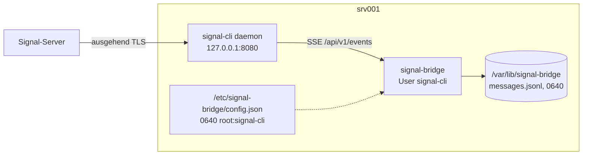

# Solution Design: HAD-0002 – Absenderfreigabe und Chat-Log

## Metadaten

| Feld | Wert |
| :--- | :--- |
| Ticket | HAD-0002 (siehe `backlog.md`) |
| Feature / Epic | Signal-Integration |
| Priorität | High |
| Übergreifendes Design | `specs/signal-integration/design.md` |
| Vorgänger | HAD-0001 (`specs/signal-integration/HAD-0001-empfangsdienst.md`) |
| Dokumenttyp | Solution Design, umsetzungsbegleitend |
| Status | Entwurf, Implementierung angelegt |

## Ziel

Ein Dienst liest den Ereignisstrom des `signal-cli`-Daemons, entscheidet anhand
einer expliziten Allowlist, ob ein Absender Befehle ausführen darf, und schreibt
jede eingegangene Nachricht in ein lokales Protokoll mit lesbarem Zeitstempel und
Absenderkennung.

In diesem Ticket wird **nichts ausgewertet und nichts an Home Assistant
weitergeleitet**. Die Entscheidung wird nur festgehalten, damit HAD-0003 und
HAD-0004 darauf aufsetzen können.

## Abgrenzung

| Thema | Zuständiges Ticket |
| :--- | :--- |
| Erkennung der Kommandos `HO M an/aus/Status` | HAD-0003 |
| Aufruf von Home Assistant | HAD-0004 |
| Antworten an den Absender | HAD-0005 |
| End-to-End-Abnahme | HAD-0006 |
| Verwaltungsoberfläche für Allowlist und Log | HAD-0008 |

## Architektur



Die Bridge ist ein reiner Konsument. Sie öffnet keine Ports, sendet keine
Nachrichten und hält keine eigenen Schlüssel.

## Entscheidungen

| ID | Entscheidung | Begründung |
| :--- | :--- | :--- |
| B1 | Python 3 mit Standardbibliothek, keine Fremdpakete | Auf `srv001` vorhanden, keine Abhängigkeitspflege, gut testbar |
| B2 | Anbindung über `GET /api/v1/events` (SSE) auf Loopback | In HAD-0001 verifiziert; der Daemon muss nicht umkonfiguriert werden |
| B3 | Protokoll als JSON Lines | Zeilenweise lesbar, robust beim Anhängen, leicht filterbar |
| B4 | Allowlist als JSON-Konfiguration, nicht in der Datenbank | Kleine, selten geänderte Liste; versionierbar und ohne Laufzeitabhängigkeit prüfbar |
| B5 | Zuordnung primär über UUID, Nummer nur als Rückfall | Die Nummer kann neu vergeben werden, die UUID nicht |
| B6 | Alle Nachrichten werden protokolliert, nicht nur die blockierten | Erfüllt die Anforderung und macht Fehlkonfigurationen der Allowlist sichtbar |
| B7 | Aufbewahrung über `retention_days`, Bereinigung beim Start und stündlich | Kein zusätzlicher Timer nötig, Verhalten bleibt im Dienst sichtbar |
| B8 | Logdatei `0640`, Verzeichnis `0750`, Gruppe `signal-cli` | Nur Dienst und ausdrücklich hinzugefügte Administratoren lesen |
| B9 | Kein Sendepfad, keine Home-Assistant-Verbindung | Ticketumfang; verhindert vorzeitige Wirkung ohne Kommandoerkennung |

## Datenmodell

### Protokolleintrag

Ein Eintrag pro Zeile, JSON Lines:

```json
{
  "ts": "2026-11-16T14:25:51+01:00",
  "received_ms": 1794820723054,
  "sender_number": "+49XXXXXXXXXX",
  "sender_uuid": "0929926d-1816-4157-9e5f-f57862547f66",
  "sender_name": "Matthias",
  "text": "Test Had",
  "attachments": 0,
  "decision": "allowed",
  "reason": "allowlist",
  "matched_label": "Matthias"
}
```

| Feld | Bedeutung |
| :--- | :--- |
| `ts` | Lesbarer Zeitstempel in der konfigurierten Zeitzone, ISO 8601 mit Offset |
| `received_ms` | Original-Zeitstempel aus dem Envelope in Millisekunden |
| `sender_number` | Rufnummer des Absenders, falls vorhanden |
| `sender_uuid` | Stabile Absenderkennung (ACI) |
| `sender_name` | Profilname, falls übertragen |
| `text` | Nachrichtentext, `null` bei reiner Anhangsnachricht |
| `attachments` | Anzahl Anhänge |
| `decision` | `allowed` oder `blocked` |
| `reason` | `allowlist`, `not_in_allowlist` oder `sender_disabled` |
| `matched_label` | Bezeichnung des Allowlist-Eintrags, sonst `null` |

### Konfiguration

```json
{
  "events_url": "http://127.0.0.1:8080/api/v1/events",
  "log_path": "/var/lib/signal-bridge/messages.jsonl",
  "retention_days": 30,
  "timezone": "Europe/Berlin",
  "read_timeout_seconds": 300,
  "reconnect_delay_seconds": 5,
  "prune_interval_seconds": 3600,
  "allowlist": [
    {
      "label": "Matthias",
      "number": "+49XXXXXXXXXX",
      "uuid": "00000000-0000-0000-0000-000000000000",
      "enabled": true
    }
  ]
}
```

## Allowlist-Semantik

Ein Absender gilt als freigegeben, wenn ein Eintrag mit `enabled: true` passt.

| Eintrag | Eingehend | Ergebnis |
| :--- | :--- | :--- |
| UUID gesetzt | UUID gleich | freigegeben |
| UUID gesetzt | UUID abweichend, Nummer gleich | **nicht** freigegeben – die Nummer wurde offenbar neu vergeben |
| UUID gesetzt | keine UUID übertragen | nicht freigegeben, nicht verifizierbar |
| nur Nummer gesetzt | Nummer gleich | freigegeben |
| `enabled: false` | beliebig | nicht freigegeben, Grund `sender_disabled` |
| kein Eintrag | beliebig | nicht freigegeben, Grund `not_in_allowlist` |

Die strengere UUID-Regel ist beabsichtigt: Eine neu vergebene Rufnummer darf
nicht automatisch Befehlsrechte erben.

## Aufbewahrung und Löschung

- `retention_days` bestimmt die Frist; Standard 30 Tage.
- Bereinigung beim Start und anschließend im Abstand von
  `prune_interval_seconds`.
- Die Bereinigung schreibt die Datei neu und behält nur Einträge innerhalb der
  Frist. Bei ungültigen Zeilen wird die Zeile verworfen und gezählt.
- Manuelles Löschen ist das Entfernen der Datei bei gestopptem Dienst; die
  Datei wird beim nächsten Start neu angelegt.

## Umsetzungsschritte

### B0 – Voraussetzungen

- [ ] HAD-0001 abgeschlossen, Daemon aktiv, `/api/v1/events` erreichbar
- [ ] Python 3 auf `srv001` vorhanden
- [ ] UUID des freizugebenden Absenders bekannt

Die UUID steht im Protokolleintrag der ersten Testnachricht oder in der Ausgabe
von `listAccounts`/`listContacts`. Sie ist die verlässlichere Kennung.

### B1 – Code und Konfiguration bereitstellen

- [ ] `signal-bridge/` nach `/opt/signal-bridge` kopieren
- [ ] `/etc/signal-bridge/config.json` aus der Vorlage erzeugen, Rechte `0640`
- [ ] Allowlist mit UUID und Nummer des freigegebenen Absenders füllen

### B2 – Dienst starten

- [ ] Unit installieren, `daemon-reload`, `enable --now`
- [ ] Journal auf Startfehler prüfen

### B3 – Nachweis der Allowlist

- [x] Nachricht vom freigegebenen Absender senden, Eintrag mit `decision: allowed`
- [x] Nachricht von einem nicht freigegebenen Absender senden, Eintrag mit
      `decision: blocked` und `reason: not_in_allowlist`
- [x] Sicherstellen, dass in beiden Fällen keine Home-Assistant-Aktion erfolgt

Erfüllt am 2026-11-17. Mit leerer Allowlist kam die Nachricht als
`"decision":"blocked","reason":"not_in_allowlist"` an. Nach Eintrag von Nummer
und UUID aus dem Protokoll erschien `"decision":"allowed","reason":"allowlist",
"matched_label":"Matthias"`. Das Journal bestätigt zusätzlich
`Nachricht von 0929926d-…: allowed (allowlist)`. Eine Home-Assistant-Aktion
findet nicht statt, weil der Code keinen ausgehenden Aufruf enthält.

### B4 – Nachweis der Aufbewahrung

- [x] `retention_days` testweise auf einen kleinen Wert setzen
- [x] Bereinigung auslösen und prüfen, dass ältere Einträge entfernt werden
- [x] Wert zurückstellen

Erfüllt am 2026-11-17. Ein synthetischer Eintrag mit Zeitstempel aus 2020 wurde
angehängt, `retention_days` auf 1 gesetzt und `--prune-now` ausgeführt:
`Aufbewahrung: 2 behalten, 1 entfernt`. Danach enthielt die Datei zwei Zeilen,
der Testeintrag war nicht mehr vorhanden. Anschließend wurde der Wert auf 30
zurückgestellt und der Dienst neu gestartet.

### B5 – Rechte prüfen

- [x] `stat` auf Logdatei und Verzeichnis
- [x] Lesbarkeit als Administrator, Nicht-Lesbarkeit als fremder Benutzer

Erfüllt am 2026-11-17. Logdatei `0640 signal-cli:signal-cli`, Verzeichnis `0750`.
Ein Benutzer in der Gruppe `signal-cli` liest das Protokoll ohne sudo. Eine
Sitzung ohne diese Gruppenmitgliedschaft erhielt `Permission denied` – der
Gegentest ist damit unbeabsichtigt, aber echt erbracht.

## Verifikationsmatrix

| Anforderung aus HAD-0002 | Nachweis | Schritt |
| :--- | :--- | :--- |
| Explizite Absender-Allowlist | Konfiguration mit UUID und Nummer, Entscheidung im Log | B1, B3 |
| Nachrichten nicht freigegebener Absender protokolliert | Eintrag mit `decision: blocked` | B3 |
| Absender und Empfangszeit im Log | Felder `sender_uuid`, `sender_number`, `ts` | B3 |
| Keine Auswertung als Kommando | Kein Kommando-Parser im Code | B1 |
| Keine Weiterleitung an Home Assistant | Keine HTTP-Aufrufe außer dem Ereignisstrom | B1 |
| Log nur für Administratoren | `0640`, Verzeichnis `0750`, Gruppe `signal-cli` | B5 |
| Aufbewahrung und Löschung festgelegt | `retention_days`, Bereinigung, dokumentiertes manuelles Löschen | B4 |

Alle Nachweise wurden am 2026-11-17 auf `srv001` erbracht. Zusätzlich laufen 35
Unit-Tests lokal grün, darunter ein Test für das zeitnahe Beenden des Dienstes.

## Sicherheit

| Risiko | Auswirkung | Gegenmaßnahme |
| :--- | :--- | :--- |
| Neu vergebene Rufnummer erbt Rechte | Fremder Absender gilt als freigegeben | Zuordnung primär über UUID (B5) |
| Log enthält private Inhalte | Offenlegung bei falschen Rechten | `0640`, `0750`, Aufbewahrungsfrist |
| Unauthentifizierter JSON-RPC-Port | Lokaler Benutzer kann als Bot senden | Bridge sendet nicht; Port bleibt Loopback |
| Fehlkonfiguration der Allowlist | Berechtigter Absender wird blockiert | `decision` und `reason` im Log machen es sichtbar |
| Absturz der Bridge | Kein Protokoll, aber auch keine Aktion | `Restart=always`, Journal zeigt Ursache |

## Betrieb

- **Status:** `systemctl status signal-bridge.service`
- **Log lesen:** `tail -n 20 /var/lib/signal-bridge/messages.jsonl` (Mitglied der
  Gruppe `signal-cli`), sonst `sudo -u signal-cli tail -n 20 …`
- **Filter:** `grep '"decision":"blocked"' /var/lib/signal-bridge/messages.jsonl`
- **Konfiguration prüfen:** `python3 /opt/signal-bridge/bridge.py --config /etc/signal-bridge/config.json --check-config`
- **Aufbewahrung sofort anwenden:** `python3 /opt/signal-bridge/bridge.py --config /etc/signal-bridge/config.json --prune-now`
- **Neustart nach Konfigurationsänderung:** `sudo systemctl restart signal-bridge.service`

Der Ereignisstrom wird in einem Daemon-Thread gelesen, der Hauptthread prüft das
Stop-Flag im Sekundentakt. Ohne diese Trennung blockiert ein offener
Socket-Read das Beenden, und `systemctl restart` läuft in `TimeoutStopSec`.
Die Unit setzt `TimeoutStopSec=20` als Sicherheitsnetz.

## Übergabe an Folgetickets

- **HAD-0003:** Der Kommando-Parser setzt auf `decision == "allowed"` auf. Die
  Normalisierung von Groß- und Kleinschreibung gehört dorthin, nicht in die
  Bridge.
- **HAD-0004:** Der Home-Assistant-Aufruf erfolgt erst nach erfolgreicher
  Kommandoerkennung; die Bridge bleibt frei von ausgehenden Aufrufen.
- **HAD-0005:** Antworten benötigen einen Sendepfad, der hier bewusst fehlt.
- **HAD-0008:** Die Weboberfläche liest dieselbe Konfiguration und dasselbe Log;
  Änderungen müssen die Dateirechte erhalten.
