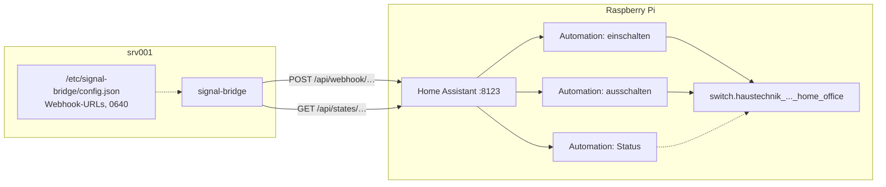

# Solution Design: HAD-0004 – Home-Assistant-Steuerung und Statusabfrage

## Metadaten

| Feld | Wert |
| :--- | :--- |
| Ticket | HAD-0004 (siehe `backlog.md`) |
| Feature / Epic | Signal-Integration |
| Priorität | High |
| Übergreifendes Design | `specs/signal-integration/design.md` |
| Vorgänger | HAD-0003 (`specs/signal-integration/HAD-0003-kommandoerkennung.md`) |
| Dokumenttyp | Solution Design, umsetzungsbegleitend |
| Status | umgesetzt, Abnahme offen |

## Ziel

`HO M an` und `HO M aus` schalten den Switch
`switch.haustechnik_shc41ccf4_matthias_im_home_office`. `HO M Status` liest
dessen aktuellen Zustand. Beides erfolgt ausschließlich über das Heimnetz und
ohne breit berechtigten Home-Assistant-API-Token auf `srv001`.

## Abgrenzung

| Thema | Zuständiges Ticket |
| :--- | :--- |
| Antwort an den Absender | HAD-0005 |
| End-to-End-Abnahme | HAD-0006 |
| Verwaltungsoberfläche | HAD-0008 |

## Architektur



Schaltbefehle laufen über Webhooks und brauchen keinen Token. Der Status wird
über die REST-API gelesen, weil Webhooks in Home Assistant keine Daten
zurückgeben können. Dafür existiert ein dedizierter Nicht-Admin-Benutzer, dessen
Token nur für einen GET auf genau eine Entität verwendet wird.

## Entscheidungen

| ID | Entscheidung | Begründung |
| :--- | :--- | :--- |
| D1 | Webhooks statt REST-API mit Token | Ein Long-Lived-Token erbt die Rechte seines Benutzers und wäre damit breit berechtigt. Webhooks erlauben genau eine Aktion pro ID |
| D2 | Drei getrennte Webhook-IDs für an, aus und Status | Kein Webhook kann mehr als seine eine Aktion auslösen |
| D3 | `local_only: true` in den Automationen | Aufrufe von außerhalb des Heimnetzes werden abgelehnt |
| D4 | Status über `GET /api/states/<entity>` mit dediziertem Nicht-Admin-Token | Webhooks können in Home Assistant keine Daten zurückgeben; am 2026-11-17 dreifach verifiziert (Test, Doku, Quellcode `webhook/trigger.py`). Ein Nicht-Admin-Benutzer ist der engste Zugang, den Home Assistant bietet |
| D5 | Webhook-IDs nur in `/etc/signal-bridge/config.json` und in Home Assistants `secrets.yaml` | Beides sind Geheimnisse; das Repository enthält nur Platzhalter |
| D6 | Aktion nur bei `actionable == true` | Verhindert Ausführung durch nicht freigegebene Absender oder bei unbekannten Texten |
| D7 | Ergebnis der Aktion im Protokolleintrag | Grundlage für die Antworten aus HAD-0005 und für die Fehlerdiagnose |
| D8 | Fehlertexte ohne URL | Die Webhook-ID darf nicht im Protokoll landen |
| D9 | Namensschema `signal_ho_<person>_<aktion>` | `HO M` steht für Home Office Matthias. Mit `HO S` für Stefaniya kommen später eigene Automationen und Webhooks hinzu, ohne bestehende umzubenennen |
| D10 | Schaltbefehle bleiben tokenfrei | Der Token wird ausschließlich für den Status-GET verwendet. Die Webhook-IDs bleiben geheim, damit der Schreibpfad nicht über den Token läuft |

## Konfiguration

```json
"home_assistant": {
  "enabled": true,
  "timeout_seconds": 10,
  "actions": {
    "on": "http://<pi>:8123/api/webhook/<id-on>",
    "off": "http://<pi>:8123/api/webhook/<id-off>"
  },
  "status": {
    "url": "http://<pi>:8123/api/states/switch.haustechnik_shc41ccf4_matthias_im_home_office",
    "token": "<long-lived-token>"
  }
}
```

Bei `enabled: true` müssen `on` und `off` vorhanden sein, sonst bricht der Start
mit einer klaren Meldung ab. Fehlt der Abschnitt `status`, werden Kommandos
erkannt und geschaltet, aber `HO M Status` meldet
`"detail": "Statusabfrage nicht konfiguriert"`. Bei `enabled: false` wird nichts
ausgeführt; das Protokoll vermerkt `"detail": "Anbindung deaktiviert"`.

## Protokollerweiterung

| Feld | Bedeutung |
| :--- | :--- |
| `action.attempted` | `true`, wenn ein Webhook aufgerufen wurde |
| `action.ok` | `true` bei Erfolg, `false` bei Fehler, `null` wenn nicht ausgeführt |
| `action.detail` | Zustand bei Statusabfrage, sonst Fehlertext oder Grund |

Beispiel für eine Statusabfrage:

```json
{"ts":"2026-11-17T16:20:03+01:00","received_ms":1794928803000,"sender_number":"+49…","sender_uuid":"0929…","sender_name":"Matthias","text":"HO M status","attachments":0,"decision":"allowed","reason":"allowlist","matched_label":"Matthias","command":"status","actionable":true,"action":{"attempted":true,"ok":true,"detail":"on"}}
```

## Home-Assistant-Seite

Die Vorlage liegt in `deploy/home-assistant/signal_ho_commands.yaml`. Sie
enthält drei Automationen mit `!secret`-Verweisen auf die Webhook-IDs.

| Automation | Secret | Aktion |
| :--- | :--- | :--- |
| `signal_ho_m_on` | `signal_ho_m_on_webhook` | `switch.turn_on` auf den Home-Office-Switch |
| `signal_ho_m_off` | `signal_ho_m_off_webhook` | `switch.turn_off` auf den Home-Office-Switch |

Eine Status-Automation gibt es nicht. Der Zustand wird direkt über
`GET /api/states/<entity>` gelesen.

### Dedizierter Benutzer für den Status

1. In Home Assistant unter Einstellungen → Personen eine Person `signal-bridge`
   anlegen, **ohne** Administratorrechte.
2. Als diese Person anmelden, im Profil unter Sicherheit einen Long-Lived
   Access Token erzeugen.
3. Token in `/etc/signal-bridge/config.json` unter `home_assistant.status.token`
   eintragen. Die Datei hat `0640 root:signal-cli`.
4. Der Token wird nur für einen GET auf die Switch-Entität verwendet und
   erscheint in keinem Log.

Das Schema ist auf weitere Personen vorbereitet: `HO S` erhält später
`signal_ho_s_on`, `signal_ho_s_off` und `signal_ho_s_status` mit eigenen
Secrets. Die Bridge braucht dafür nur zusätzliche Einträge unter
`home_assistant.actions`, weil die Schlüssel den Kommandowerten entsprechen.

### Warum nicht der MCP-Server

Auf dem Entwicklungsrechner existiert ein MCP-Server für Home Assistant
(`MCPStart.ps1`, `~/.copilot/mcp-config.json`). Er läuft als stdio-Prozess im
Kontext von VS Code und ist kein Dienst. Zwei Gründe sprechen gegen eine
Nutzung durch die Bridge:

1. Ein stdio-Prozess auf einem anderen Rechner ist von einem systemd-Dienst auf
   `srv001` nicht erreichbar.
2. Der dort hinterlegte `HOMEASSISTANT_TOKEN` ist ein Long-Lived-Token mit den
   Rechten seines Benutzers. Auf `srv001` abgelegt wäre er genau der breit
   berechtigte Zugang, den dieses Ticket vermeiden soll.

Der MCP-Server bleibt ein Werkzeug für die Entwicklung, nicht für den Betrieb.

Die bestehenden Automationen, die auf Zustandsänderungen die Solltemperatur
setzen, bleiben unverändert. Die Signal-Integration schaltet nur den Switch.

## Umsetzungsschritte

### D0 – Voraussetzungen

- [x] HAD-0003 abgeschlossen, `actionable` im Protokoll
- [ ] Home Assistant erreichbar, Version mit Webhook-Antworten
- [ ] Drei Webhook-IDs erzeugt und in `secrets.yaml` hinterlegt

### D1 – Bridge-Seite

- [x] `ha_client.py` mit `call_webhook` und `perform_action`
- [x] Konfigurationsabschnitt `home_assistant` mit Validierung
- [x] Aktion nur bei `actionable`, Ergebnis im Protokoll
- [x] Fehlertexte ohne URL

### D2 – Home-Assistant-Seite

- [ ] `automations_signal.yaml` eingebunden
- [ ] Drei Secrets gesetzt
- [ ] Home Assistant neu gestartet, Automationen geladen

### D3 – Nachweis

- [x] `HO M an` → `action.ok: true`, Switch ist an
- [x] `HO M aus` → `action.ok: true`, Switch ist aus
- [x] `HO M status` → `action.detail` enthält `on` oder `off`
- [x] Fehlerpfad bei nicht erreichbarem oder ablehnendem Home Assistant
- [ ] `HO M an` von nicht freigegebenem Absender → keine Aktion

Erfüllt am 2026-11-17 auf `srv001`. `HO M an` und `HO M aus` ergaben
`"action":{"attempted":true,"ok":true,"detail":null}`, der Switch schaltete
tatsächlich. `HO M status` ergab `"ok":true,"detail":"off"`.

Der Fehlerpfad wurde durch einen doppelt eingefügten Token belegt: Das Protokoll
zeigte `"ok":false,"detail":"HTTP 401"`, ohne eine erfolgreiche Ausführung
vorzutäuschen. Nach Korrektur des Tokens lieferte dieselbe Abfrage den Zustand.

Der Fall „nicht freigegebener Absender" ist durch den Unit-Test
`test_blocked_command_is_not_actionable` abgedeckt, auf `srv001` aber nicht
separat geprüft.

### D4 – Idempotenz

- [ ] `HO M an` zweimal senden → beide Male `ok: true`, Zustand bleibt an

Nicht separat geprüft. `switch.turn_on` und `switch.turn_off` sind idempotent,
und die Bridge kennt keinen Umschaltbefehl. Die Anforderung stammt ohnehin aus
HAD-0005 und wird dort Ende-zu-Ende geprüft.

## Verifikationsmatrix

| Anforderung aus HAD-0004 | Nachweis | Schritt |
| :--- | :--- | :--- |
| `HO M an` schaltet den Switch ein | `action.ok: true`, Switch-Zustand `on` | D3 |
| `HO M aus` schaltet den Switch aus | `action.ok: true`, Switch-Zustand `off` | D3 |
| `HO M Status` liefert den Zustand | `action.detail` = `on` oder `off` | D3 |
| Zugriff nur über das Heimnetz | Webhook-URLs zeigen auf die LAN-Adresse des Pi, `local_only: true` | D2 |
| Kein breit berechtigter API-Zugang | Kein Token, keine REST-API, nur Webhooks | D1 |
| Bestehende Automationen bleiben wirksam | Nur `switch.turn_on`/`turn_off`, keine Heizungslogik | D2 |
| Keine Aktion ohne Freigabe | Aktion nur bei `actionable == true` | D1, D3 |

## Sicherheit

| Risiko | Auswirkung | Gegenmaßnahme |
| :--- | :--- | :--- |
| Webhook-ID gelangt in ein Log | Fremder könnte schalten | Fehlertexte ohne URL (D8), IDs nur in geschützter Konfiguration |
| Webhook von außen erreichbar | Steuerung aus dem Internet | `local_only: true` (D3) |
| Unverschlüsselter HTTP-Verkehr | Mitlesen im LAN | Verkehr bleibt im Heimnetz; bei Bedarf später HTTPS mit lokalem Zertifikat |
| Fehlkonfiguration führt zu stiller Nichtausführung | Kommando wirkt nicht | `action.attempted` und `action.detail` im Protokoll |
| Wiederholte Kommandos | Unerwarteter Zustandswechsel | `turn_on`/`turn_off` sind idempotent, kein `toggle` |

## Übergabe an Folgetickets

- **HAD-0005:** nutzt `command` und `action` für die Antwort. Bei `ok: false`
  muss ein Fehler gemeldet werden, ohne Erfolg vorzutäuschen.
- **HAD-0006:** prüft zusätzlich den Fall eines nicht erreichbaren Home
  Assistant und den unbekannten Switch-Zustand.
- **HAD-0008:** zeigt Verbindungsstatus und letzte Fehler; die Webhook-IDs
  bleiben in der geschützten Konfiguration.
